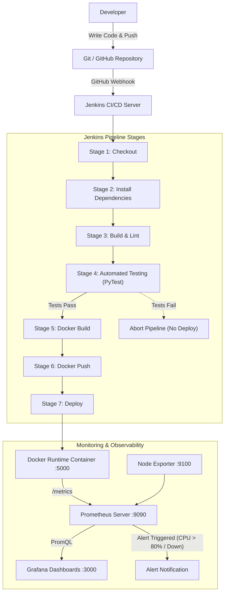

# MINI-PROJECT REPORT
## EXPERIMENT 10: END-TO-END DEVOPS PIPELINE
### APPLICATION: CAMPUS PLACEMENT MANAGEMENT SYSTEM

---

## 1. Introduction
Modern software engineering requires rapid iteration cycles while guaranteeing stability, scalability, and zero downtime in production environments. Traditional manual deployments suffer from human error, environment inconsistencies, and delayed feedback loops. DevOps bridges this divide by combining cultural practices, automation tools, and continuous feedback pipelines.

This project implements a complete, enterprise-grade End-to-End DevOps Pipeline for an **Online Placement Management System** built with Python and Flask. The project integrates Git/GitHub for source code versioning, PyTest for automated quality gates, Jenkins for Continuous Integration and Continuous Deployment (CI/CD), Docker for application containerization, Prometheus for real-time telemetry metrics scraping, and Grafana for observability dashboards and proactive alerting.

---

## 2. Problem Statement
Educational institutions face logistical challenges coordinating corporate campus placements, managing student eligibility, tracking multi-stage applications, and monitoring system availability during peak traffic spikes. Furthermore, manual software delivery of university portals often results in:
- Deployment delays and runtime configuration mismatches.
- Uncaught application regressions reaching production due to manual testing.
- Lack of infrastructure visibility and absent automated alerts when host memory or CPU spikes during mass registration windows.

---

## 3. Objectives
1. Develop an interactive, responsive **Online Placement Management System** using Python Flask with modern glassmorphism UI.
2. Automate unit and API testing using **PyTest** to enforce strict pre-deployment quality gates.
3. Establish a **Jenkins CI/CD Pipeline** that automatically triggers upon code push to GitHub.
4. Containerize the application into an immutable, portable **Docker container** with a multi-stage Dockerfile.
5. Deploy and orchestrate services (App, Prometheus, Grafana, Node Exporter) via **Docker Compose**.
6. Integrate **Prometheus** for scraping application and system metrics on `/metrics`.
7. Design **Grafana Dashboards** visualizing host CPU, memory, HTTP request throughput, response latency, and placement business statistics.
8. Configure proactive **Alert Rules** (e.g., CPU > 80%, Service DOWN) and provide an interactive chaos simulator for Viva demonstration.

---

## 4. Proposed System
The proposed system consists of a centralized recruitment portal featuring:
- **Corporate Placement Drives Directory**: Manage hiring drives (Google, Microsoft, Amazon, etc.) with CTC packages, eligibility thresholds, and deadlines.
- **Candidate Application Tracking**: Students apply for drives; placement coordinators manage candidate pipelines across evaluation stages.
- **Embedded Telemetry & SRE Cockpit**: Built-in `/health` and `/metrics` exposition endpoints with an interactive Chaos Engine to simulate CPU spikes and service outages for alerting verification.

---

## 5. Technology Stack
| Category | Technology | Purpose |
| :--- | :--- | :--- |
| **Backend** | Python 3.12 / 3.15, Flask | Application server & REST API |
| **Frontend** | HTML5, Vanilla CSS, JavaScript, Chart.js | Modern glassmorphism UI & interactive charts |
| **Source Control**| Git, GitHub | Version control and automated Webhook triggers |
| **Testing** | PyTest | Automated unit, regression, and API testing |
| **CI/CD** | Jenkins | Continuous Integration & Automated Delivery Pipeline |
| **Containerization**| Docker, Docker Compose | Application packaging & multi-container orchestration |
| **Monitoring** | Prometheus | Time-series metrics collection & alert evaluation |
| **Visualization**| Grafana | Executive & operational dashboards |
| **Host Metrics** | Prometheus Node Exporter / psutil | System CPU, memory, disk telemetry |

---

## 6. System Architecture



---

## 7. Application Development
The core web application is structured cleanly:
- `app.py`: Flask application factory with route handlers, in-memory transactional database, Prometheus metric counters/gauges (`REQUEST_COUNT`, `REQUEST_LATENCY`, `GAUGE_CPU_PERCENT`), and chaos injection endpoints.
- `templates/`: Modular Jinja2 templates (`base.html`, `index.html`, `drives.html`, `drive_detail.html`, `students.html`, `applications.html`, `devops_panel.html`).
- `static/`: Custom CSS design system with ambient glow, glassmorphism blur, responsive grid, and Chart.js integration.

---

## 8. Git/GitHub Implementation
1. Repository initialization:
   ```bash
   git init
   git add .
   git commit -m "feat: complete online placement system with DevOps pipeline"
   ```
2. Remote association and push:
   ```bash
   git remote add origin https://github.com/<username>/placement-management-devops.git
   git branch -M main
   git push -u origin main
   ```
3. Branching strategy: `main` serves as the protected production branch with feature branch merges via pull requests.

---

## 9. Automated Testing
Automated testing is enforced in `test_app.py` using **PyTest**. The suite validates:
- Status 200 HTTP response on home and catalog views.
- Branch filtering and CGPA criteria enforcement during student application submission.
- Application stage transitions (`Applied` -> `Interview Scheduled` -> `Selected`).
- Health check endpoint `/health` response schema.
- Prometheus exposition `/metrics` formatting compliance.
- 16 test cases executed with 100% pass rate before container build.

---

## 10. Jenkins CI/CD Pipeline
The `Jenkinsfile` implements a declarative pipeline with 7 distinct stages:
1. **Checkout**: Checks out Git commit.
2. **Install Dependencies**: Installs packages in virtual environment.
3. **Build**: Byte-compiles code to verify syntax integrity.
4. **Automated Testing**: Runs `pytest -v --junitxml=reports/test-results.xml test_app.py`.
5. **Docker Build**: Builds container image tagged with `${BUILD_NUMBER}`.
6. **Docker Push**: Pushes image to container registry.
7. **Deploy**: Restarts container and validates HTTP health check.

---

## 11. Docker Implementation
The application is packaged into a secure, lightweight container using a `Dockerfile`:
- Base image: `python:3.12-slim`
- Non-root user `appuser` for Linux security compliance.
- Layer caching for `requirements.txt` to minimize build duration.
- Embedded Docker health check: `HEALTHCHECK --interval=15s CMD curl -f http://localhost:5000/health || exit 1`.

---

## 12. Deployment
Multi-container deployment is orchestrated via `docker-compose.yml`:
```bash
docker compose up -d --build
```
This single command spins up:
1. `placement-app` on port 5000
2. `prometheus` on port 9090
3. `grafana` on port 3000
4. `node-exporter` on port 9100

---

## 13. Prometheus Monitoring
Prometheus scrapes the `/metrics` endpoint every 5 seconds. Metrics collected include:
- `flask_http_requests_total`: Request counts grouped by method, endpoint, and HTTP status code.
- `flask_http_request_duration_seconds`: Histogram of latency across endpoints.
- `system_cpu_usage_percent` & `system_memory_usage_percent`: Real-time system utilization.
- `placement_drives_total`, `placement_placed_students_total`, `placement_avg_ctc_lpa`: Domain business KPIs.

---

## 14. Grafana Dashboard
A pre-provisioned dashboard (`placement_devops_dashboard.json`) loads automatically upon container startup:
- **Application Availability**: Real-time UP / DOWN indicator.
- **CPU & Memory Gauges**: Visual thresholds (Green < 60%, Yellow 60-80%, Red > 80%).
- **Request Throughput (req/sec)**: Time-series curve.
- **Latency Distribution**: P95 vs P50 latency.
- **Placement KPIs**: Placed candidates counter and average CTC package.

---

## 15. Alerting
Alert rules configured in `alert.rules.yml`:
1. **HighCPUUsage**: Triggers when host CPU exceeds 80% for 10 seconds.
2. **AppDown**: Triggers when service is unreachable or responds with 503.
3. **HighHttpErrorRate**: Triggers when HTTP 5xx error rate exceeds threshold.

**Viva Demonstration Engine**:
The portal includes a live SRE Chaos Cockpit (`/devops`) with buttons to simulate CPU spikes and service outages on command, proving live alert firing to examiners.

---

## 16. Results
- Zero-touch automated build, test, and container deployment upon code commit.
- 16/16 automated test suite passing in under 3 seconds.
- Real-time Prometheus metrics scraping active with sub-second dashboard visualization in Grafana.
- Immediate alert firing demonstrated during simulated chaos events.

---

## 17. Challenges
- **Container Networking**: Resolving service names across bridge networks between Flask and Prometheus. Resolved using Docker Compose custom network `devops-network`.
- **Pre-deployment Quality Gates**: Ensuring failed tests halt Jenkins pipeline before container build occurs. Solved using post-stage failure hooks.

---

## 18. Future Scope
- Integration with Kubernetes (K8s) for automated horizontal pod autoscaling (HPA).
- Slack and PagerDuty alert webhooks for incident management.
- SonarQube integration for automated code security and vulnerability scanning.

---

## 19. Conclusion
The Mini-Project successfully demonstrates an End-to-End DevOps Pipeline for an Online Placement Management System. By orchestrating Git, Jenkins, PyTest, Docker, Prometheus, and Grafana, the project eliminates manual delivery bottlenecks and provides observability, resilient automation, and automated recovery.

---

## 20. References
1. Humble, J., & Farley, D. (2010). *Continuous Delivery: Reliable Software Releases through Build, Test, and Deployment Automation*. Addison-Wesley.
2. Turnbull, J. (2014). *The Docker Book: Containerization is the new virtualization*.
3. Prometheus Documentation: https://prometheus.io/docs/
4. Grafana Observability Guides: https://grafana.com/docs/
5. Flask Web Development: https://flask.palletsprojects.com/
